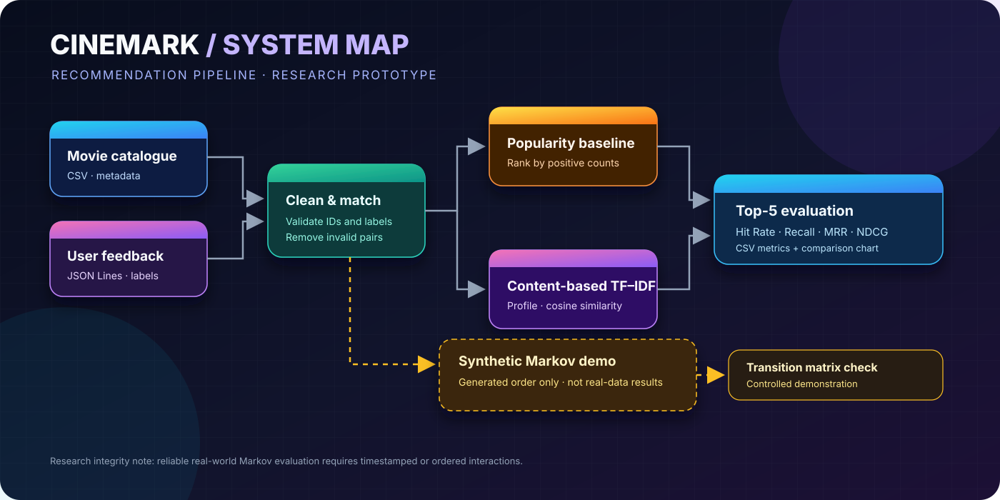
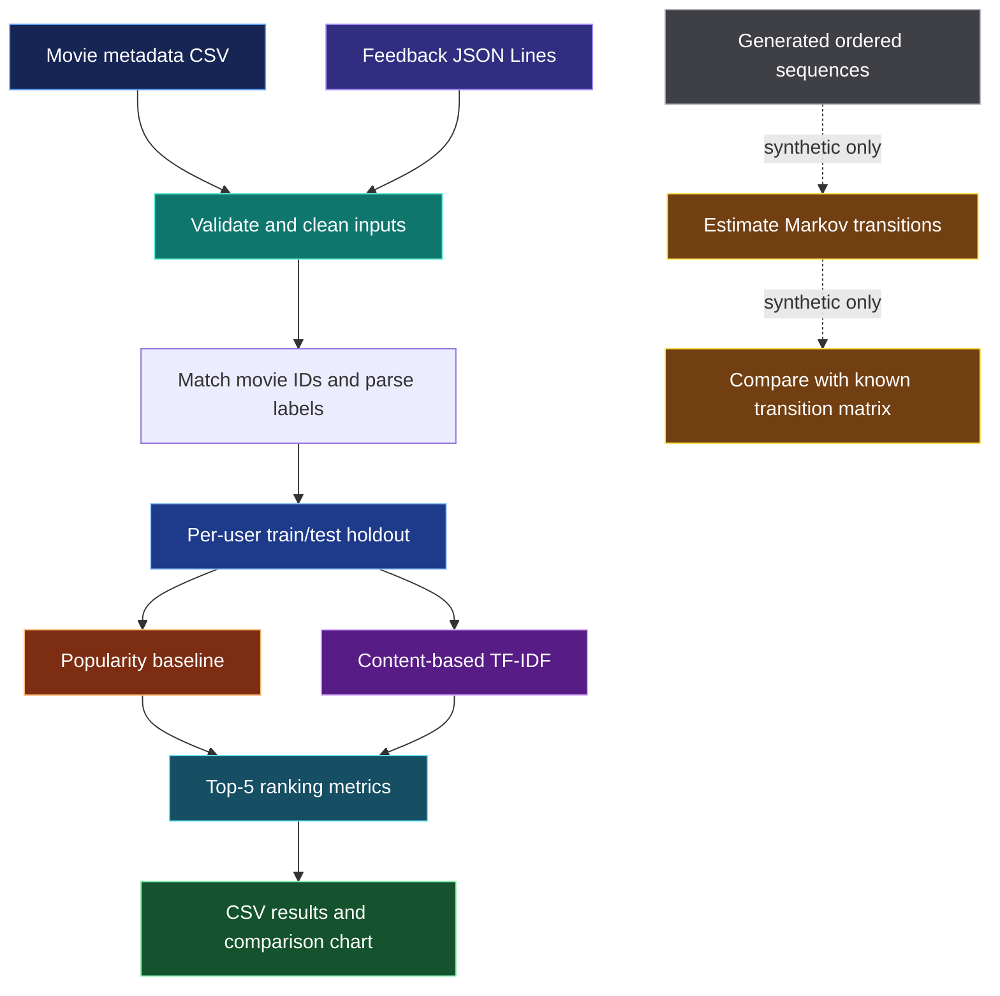

<div align="center">



# 🎬 CineMark
### Markov Chain-Based Movie Recommendation System

**A reproducible APSP research prototype for exploring movie recommendation, content similarity, ranking metrics, and Markov transitions.**

[](https://www.python.org/)
[](https://jupyter.org/)
[](https://scikit-learn.org/)
[](#-research-scope-and-limitations)

**Course:** Applied Statistics & Stochastic Processes (APSP) · **Assessment:** CAT 2 · **Group:** A11

[Overview](#-overview) · [How it works](#-how-it-works) · [Results](#-current-results) · [Run locally](#-run-locally) · [Limitations](#-research-scope-and-limitations)

</div>

---

## ✨ Overview

**CineMark** studies how movie metadata and user feedback can be used to rank movies a user may like. The notebook currently compares two recommendation baselines on the supplied feedback data:

- **Popularity baseline** — ranks movies by positive feedback in the training set.
- **Content-based TF–IDF** — represents movie metadata as text vectors and ranks unseen movies by similarity to a user's positive-history profile.
- **Markov Chain demonstration** — uses a **synthetic, ordered sequence dataset** to demonstrate state transitions. It is not a real-data Markov evaluation because the supplied feedback has no reliable event timestamps or viewing order.

> [!IMPORTANT]
> The project is a research prototype, not a production recommendation service. The current real-data evaluation is a per-user held-out positive-item test. Markov results from generated sequences must be labelled **synthetic** and must not be presented as measured performance on real CineMark user histories.

## 🧭 How it works

The diagram below summarizes the pipeline implemented in the notebook. The large top-level flow is the real-feedback evaluation; the dashed lower branch is the separate synthetic Markov experiment.



### 🔬 Recommendation logic

| Stage | What happens | Why it matters |
|---|---|---|
| 1. Validate | Check expected columns, normalize IDs, parse feedback labels | Prevents malformed records from contaminating the experiment |
| 2. Clean | Ignore non-movie form keys, remove duplicate user–movie pairs, drop feedback for unknown movie IDs | Aligns feedback with the movie catalogue |
| 3. Split | Hold out one positive movie for each eligible user with at least two positive movies | Creates a repeatable top-N retrieval test |
| 4. Recommend | Rank unseen movies with popularity counts or TF–IDF profile similarity | Provides two interpretable baselines |
| 5. Evaluate | Calculate Hit Rate@5, Recall@5, MRR@5, and NDCG@5 | Measures whether the held-out movie is retrieved and how highly it ranks |
| 6. Demonstrate Markov | Learn transitions from generated ordered sequences | Illustrates stochastic transitions without claiming unavailable real event order |

## 📊 Current results

These values are from the current `outputs/model_evaluation_results.csv` included with this project. The evaluation uses **731 test users** and one held-out positive target per user.

| Model | Hit Rate@5 | Recall@5 | MRR@5 | NDCG@5 |
|---|---:|---:|---:|---:|
| Popularity baseline | **3.83%** | **3.83%** | **0.0152** | **0.0208** |
| Content-based TF–IDF | **1.92%** | **1.92%** | **0.0102** | **0.0124** |

**Interpretation:** In this particular split, the popularity baseline outperformed the content-based TF–IDF model on all four reported metrics. This does not prove popularity is generally superior; the result may change with different splits, data, preprocessing, or ranking methods.

### What the metrics mean

- **Hit Rate@5:** fraction of test users whose held-out positive movie appears among the five recommendations.
- **Recall@5:** equals Hit Rate@5 in this setup because each test user has exactly one held-out positive target.
- **MRR@5 (Mean Reciprocal Rank):** rewards recommendations that place the target closer to rank 1.
- **NDCG@5 (Normalized Discounted Cumulative Gain):** rewards relevant items higher in the ranked list, applying a position-based discount.

> Metrics describe this fixed evaluation run. Re-run the notebook after changing the data or random seed and update this section from the generated CSV rather than assuming the values stay the same.

## 🧠 Markov Chain: what it means here

A first-order Markov model estimates the next state using the current state:

\[
P(X_{t+1}=j\mid X_t=i)
\]

In a movie recommender, a state could represent a movie and a transition probability could represent how likely a user is to move from one movie to another. Estimating meaningful transitions requires **ordered interaction events**. The supplied feedback file has no reliable timestamp or viewing order, so the notebook uses generated sequences with a known transition structure for a controlled demonstration only.

**Research next step:** obtain permission to use privacy-safe, timestamped interaction sequences, then evaluate next-item prediction chronologically against suitable baselines.

## 🗂️ Repository structure

```text
cinemark_apsp_group_a11/
├── CineMark_APSP_Group_A11.ipynb   # Main analysis and experiments
├── README.md                       # Project guide
├── requirements.txt                # Python dependencies
├── .gitignore
├── assets/
│   └── cinemark-architecture.svg   # Premium pipeline illustration
├── data/
│   ├── movies.csv                  # Movie catalogue metadata
│   └── ratings.json                # Feedback input (check privacy before publishing)
└── outputs/
    ├── data_quality_summary.csv
    ├── model_evaluation_results.csv
    ├── popularity_user_metrics.csv
    ├── content_user_metrics.csv
    ├── model_comparison.png
    ├── synthetic_markov_simulation.csv
    └── synthetic_markov_simulation.png
```

Generated output files may be refreshed when all notebook cells are run. The `ratings.json` file may contain persistent user identifiers; **do not publish it in a public repository unless the data owner has approved sharing and identifiers have been appropriately removed or transformed**. Do not upload profile exports, emails, passwords, password hashes, or other sensitive data.

## ⚙️ Run locally

### 1. Clone the repository

```bash
git clone https://github.com/Tejas-c-0/Markov-Chain-Based-Movie-Recommendation-System.git
cd Markov-Chain-Based-Movie-Recommendation-System
```

### 2. Create a virtual environment

**Windows PowerShell**

```powershell
py -m venv .venv
.\.venv\Scripts\Activate.ps1
python -m pip install --upgrade pip
pip install -r requirements.txt
jupyter notebook
```

**macOS / Linux**

```bash
python3 -m venv .venv
source .venv/bin/activate
python -m pip install --upgrade pip
pip install -r requirements.txt
jupyter notebook
```

### 3. Run the notebook

Open `CineMark_APSP_Group_A11.ipynb`, then select **Kernel → Restart Kernel and Run All Cells**. Run cells from top to bottom. Confirm that the input files are present in `data/` and that the installed Python environment matches the notebook kernel.

## 🧰 Technology stack

- **Python** — experiment implementation
- **Pandas / NumPy** — data processing and numerical operations
- **scikit-learn** — TF–IDF vectorization and text similarity
- **Matplotlib** — evaluation visualizations
- **Jupyter Notebook** — reproducible, step-by-step analysis
- **Markov Chain** — synthetic transition modelling demonstration

## 🔐 Data handling

- Use only the minimum fields required for the analysis.
- Keep user-profile exports and credentials out of the repository.
- Review `git status` before every public commit.
- If the feedback data is not approved for public redistribution, keep it local and document how an authorized reviewer can obtain it.
- Do not expose user identifiers in screenshots, reports, charts, or notebook output.

## ⚠️ Research scope and limitations

1. **No real chronological sequence:** the feedback data has no reliable timestamp or event order, so real-data Markov next-item performance cannot be measured from this file alone.
2. **Single holdout split:** the reported metrics may be sensitive to the split. Repeated seeded splits or user-level cross-validation would provide stronger evidence.
3. **One target per test user:** Hit Rate@5 and Recall@5 are equal under the current evaluation design.
4. **Sparse feedback:** many movies may have little or no user feedback.
5. **Neutral labels:** label `0` is treated as neutral/unspecified, not automatically as a dislike; `-1` is negative and `1` is positive.
6. **Metadata quality:** missing or noisy genres, descriptions, cast, or director fields may reduce content similarity quality.
7. **Prototype, not deployment:** this notebook does not implement a production API, online learning, or a live user interface.

## 🧪 Reproducibility checklist

- [ ] Use the approved versions of `movies.csv` and feedback data.
- [ ] Install dependencies from `requirements.txt`.
- [ ] Restart the kernel and run every notebook cell in order.
- [ ] Confirm the generated model-comparison CSV matches the reported metrics.
- [ ] Keep the synthetic Markov experiment clearly labelled as synthetic.
- [ ] Check that no personal data or credentials are staged for GitHub.

## 👥 Academic context

**CineMark — Group A11** · Applied Statistics & Stochastic Processes (APSP), CAT 2.

This repository is intended for academic demonstration and reproducible experimentation. Cite the original data source and document any permissions or preprocessing requirements before external or publication use.

<div align="center">

**Built for learning, tested with metrics, documented with research integrity.** 🎞️

</div>
